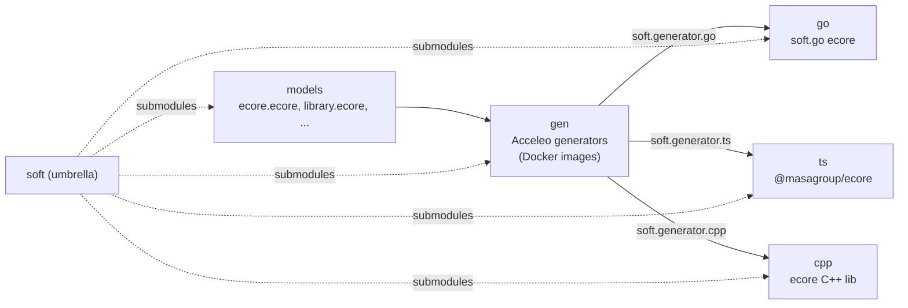
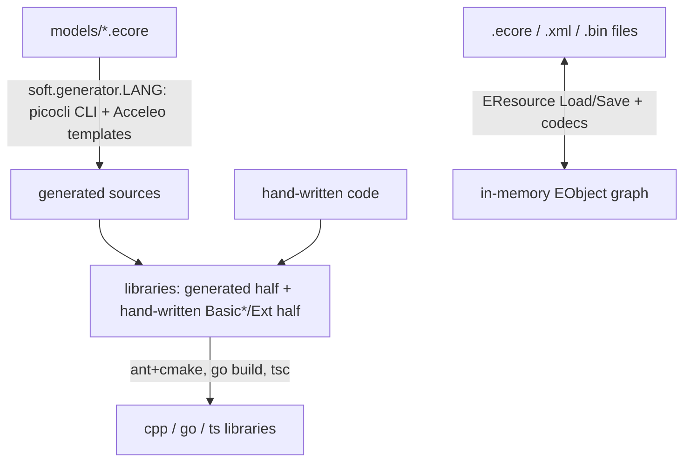

<!--
sword:
  schema: 1
  name: soft
  family: ecore-esync
  kind: build-tooling
  generation: shared
  shipped: false
  languages: [Java, C++, Go, TypeScript, Ecore]
  build: [ant, docker, go, cmake, npm, make, maven]
  ng: [ecore-model]
  apps: []
-->

# soft

[](https://github.com/masagroup/soft/blob/master/LICENSE)

> SOFT ("Sword Object Facilities") is the umbrella repository that aggregates, as git submodules, MASA's own Ecore implementation in C++, Go and TypeScript, the Acceleo code generators and the `.ecore` metamodels; it is the foundation of the ecore model code generation chain used by the SWORD ecosystem.

| | |
|---|---|
| **Family** | Ecore / esync |
| **Kind** | build tooling (umbrella of git submodules: ecore model, C++ / Go / TypeScript libraries, generators) |
| **Languages** | Umbrella itself: none. Submodules: C++17 (`cpp`), Go (`go`), TypeScript (`ts`), Java + Acceleo MTL (`gen`), Ecore XMI models (`models`) |
| **Remote / branch** | github.com/masagroup/soft, default branch `master` |
| **Generation** | shared (foundation of the generated ecore model code; the umbrella itself is dormant, see Known issues) |
| **Build systems** | none at the umbrella level · per submodule: Make + Docker BuildKit (`gen`, `go`, `ts`) · Ant + CMake/Ninja (`cpp`, Windows/MSVC only) · Go · npm · Maven (inside the generator images) |

## Overview

`soft` contains only `.gitmodules`, `README.md`, `LICENSE` and five gitlinks. All real content lives in the submodules, checked out at pinned commits. License: Mozilla Public License 2.0 (source headers: "Copyright(c) 2021 MASA Group").

SOFT implements the core of the Eclipse Modeling Framework (EObject / EClass / EPackage / EResource, notifications, XMI / XML / binary serialization) in three languages. It is bootstrapped: the same Ecore metamodel (`models/ecore.ecore`) is the input of the generators, which emit the generated half of the Ecore library itself, while a hand-written half (`Basic*`, `*Ext`, resources, codecs) lives in each library.

The libraries do no network I/O and expose no ports. The only runnable programs are the three code generators (command-line tools packaged as Docker images `masagroup/soft.generator.{go,cpp,ts}`) and the test executables. Who consumes SOFT is not visible from this repository (see Open questions).



### Submodules and pinned commits

| Path | `.gitmodules` URL | Pinned commit | Tag at pin | Role |
|---|---|---|---|---|
| `gen` (section named `java`, path `gen`) | https://github.com/masagroup/soft.gen.git | `d96e5d10` (2023-05-23) | v1.7.0 | Java/Acceleo generators for cpp, go, ts ([soft.gen](https://github.com/masagroup/soft.gen)) |
| `cpp` | https://github.com/masagroup/soft.cpp.git | `bd217da2` (2021-05-03) | v1.2.4 | C++ ecore library ([soft.cpp](https://github.com/masagroup/soft.cpp)) |
| `go` | https://github.com/masagroup/soft.go.git | `8d0a2b27` (2023-04-27) | v1.7.0 | Go ecore library ([soft.go](https://github.com/masagroup/soft.go)) |
| `ts` | https://github.com/masagroup/soft.ts.git | `3047b6e3` (2021-12-16) | v1.0.4 | TypeScript ecore library ([soft.ts](https://github.com/masagroup/soft.ts)) |
| `models` | https://github.com/masagroup/soft.models.git | `a6b7a0c1` (2023-01-11) | v1.7.0 | `.ecore` metamodels used to bootstrap the libraries ([soft.models](https://github.com/masagroup/soft.models)) |

HEAD of the umbrella: `c80fbf86` "Merge pull request #84 from SokaDance/release-v1.7.0", 2023-05-23 (last bump: "update all subprojects version to 1.7.0"). The checked-out submodules point to `git@github.com:masagroup/soft.<x>.git` and are in detached HEAD.

### Pin staleness

The umbrella is dormant. Comparison with the standalone sibling working copies (`soft.<x>`, branch master):

| Component | Pinned in `soft` | Sibling HEAD | Commits ahead of pin | Latest tag in sibling |
|---|---|---|---|---|
| soft.go | `8d0a2b27` (v1.7.0) | `4d866ae` (2026-10-14) | 723 | v1.11.1 (`go.mod`: `go 1.27.0`) |
| soft.gen | `d96e5d10` (v1.7.0) | `106258a` (2026-10-14) | 313 | v1.9.0 |
| soft.ts | `3047b6e3` (v1.0.4) | `1499ba7` (2026-10-14) | 339 | v1.6.1 |
| soft.cpp | `bd217da2` (v1.2.4) | `584851f` (2023-12-15) | 6 | v1.2.4 |
| soft.models | `a6b7a0c1` (v1.7.0) | `f0dd72e` (2024-09-19) | 24 | v1.8.0 |

The component repositories are the source of truth; anything newer than go v1.7.0, gen v1.7.0 or ts v1.0.4 must be read from their own wiki pages, not from this one.

## Repository layout

```
soft/
  .gitmodules  README.md  LICENSE
  gen/      Java + Acceleo MTL generators (soft.acceleo, soft.generators/{common,cpp,go,ts}), Makefile, Dockerfile-{base,go,cpp,ts}
  cpp/      C++17 ecore library: ecore/{lib,tests}, library/{lib,tests}, build.xml (Ant), build.properties, generator.properties
  go/       Go ecore library: ecore/ (package ecore), test/{empty,library,tournament}, Makefile, generator.properties
  ts/       TypeScript ecore library: ecore/ (@masagroup/ecore), library/ (sample + tests), Makefile
  models/   ecore.ecore (1034 lines, Ecore described in Ecore), library.ecore, tournament.ecore, empty.ecore, Eclipse launch configs
```

Tracked files in the umbrella (`git ls-tree HEAD`): `.gitmodules`, `LICENSE`, `README.md` and the five gitlinks.

## Build

There is no build system at the umbrella level: no `build.xml`, `Dockerfile`, `docker-compose.yaml`, `CMakeLists.txt`, `Makefile`, `package.json` or `.github/` at the root. Clone with submodules:

```
git clone --recurse-submodules <url>
# or, in an existing clone
git submodule update --init
```

Dependency order (derived from the Makefiles): `gen` (produces the generator Docker images) -> `go` / `ts` / `cpp` (each regenerates part of its sources from `models` using a generator image) -> tests. `models` must be a sibling directory named `models` of the library (`$(realpath ../models)` in the go and ts Makefiles, `../models` in `cpp/build.xml`); the umbrella layout (`soft/go`, `soft/models`) satisfies this.

### Windows (Ant)

Only `soft.cpp` (`cpp/`) builds with Ant, and only on Windows/MSVC. Apache Ant with `ant-contrib`; `cpp/build.xml` is at the submodule root (project `soft.cpp`, default target `all`). Docker is required for the generation steps (`docker run masagroup/soft.generator.cpp`).

From `cpp/`, in a shell initialised for MSVC (README: "Run in VC command line: ant"). On the reference workstation, MSVC is initialised first (workstation convention, not stated in the repo; `cmd` syntax, run it in the same session as `ant`):

```
call "<Visual Studio 2022 Professional install dir>\Common7\Tools\VsDevCmd.bat" -arch=amd64 -vcvars_ver=14.0 -winsdk=10.0.19041.0
ant
```

`cpp/build.properties` sets `root.dir=.`, `bin.dir`, `out.dir`, `downloads.dir`, `dist.dir`, `vcpkg.dir=${out.dir}/vcpkg`. Ant targets (none has a `description`; roles inferred from the bodies):

| Target | Role |
|---|---|
| `all` | depends on `configure,ecore,library` |
| `configure` | `tools.install,vcpkg.install` |
| `tools.install` | downloads and unpacks aria2 1.34.0, CMake 3.18.0, Ninja 1.8.2 into `bin/` (SHA-512 checks) |
| `vcpkg.install` | downloads `https://github.com/SokaDance/vcpkg/archive/turtle.zip`, bootstraps it, installs `boost-test boost-regex date turtle xerces-c` for triplet `x64-windows` |
| `ecore` | `ecore.version,ecore.generate,ecore.configure,ecore.build,ecore.tests,ecore.install,ecore.package,ecore.dist` |
| `ecore.generate` | `docker run masagroup/soft.generator.cpp -m /models/ecore.ecore -o /pwd -P /pwd/generator.properties -t !generateLibraryCMakeProject -t !generateTestsCMakeProject` |
| `ecore.configure[.vs2015/.vs2017/.vs2019/.ninja[.release/.debug]]` | CMake configure (default: vs2019 + ninja release/debug) into `out/cpp/<generator>/<project>/<config>` |
| `ecore.build[.debug/.release]`, `ecore.tests[...]` (ctest), `ecore.install`, `ecore.package` (cpack) | build, test, install, package |
| `ecore.dist` | zips to `dist/ecore-${ecore.version}-win64.zip` (`ecore.version=1.2.3`) |
| `library` | `library.generate,library.configure,library.build,library.tests` (from `models/library.ecore`; `library.configure` = vs2019 + ninja only) |
| `checksum`, `aria2.*`, `cmake.*`, `ninja.*`, `vcpkg.available` | helpers of the tool bootstrap (`checksum` prints the SHA-512 of the three tools) |
| `library.clean`, `clean` | `git clean -xfd` (`library.clean` in `library/`; `clean` at the root of `cpp` after an `attrib` on `out/go`) |

CMake entry points (no CMakeLists at the submodule root):

| File | Content |
|---|---|
| `cpp/ecore/CMakeLists.txt` | `project(ecore CXX)`, `enable_testing()`, optional vcpkg toolchain from `VCPKG_ROOT`; `add_subdirectory(lib)` and `tests` |
| `cpp/ecore/lib/CMakeLists.txt` | generated by `soft.generator.cpp`; `project(ecore.lib VERSION 1.2.3)`; `CMAKE_CXX_STANDARD 17`; targets `ecore` (SHARED, alias `ecore::shared`, output name `ecore-vc<toolset>-mt[-gd]`) and `ecore.static` (STATIC, `ECORE_STATIC_LIB`, alias `ecore::static`); `find_package(XercesC Threads Boost[regex] Date)`; MSVC-only options `/MP /wd4250 /wd4251 /bigobj`; install export `EcoreTargets.cmake` (namespace `Ecore::`), CPack generator ZIP |
| `cpp/ecore/tests/CMakeLists.txt` | executable `ecore.tests` (Boost.Test static + Turtle) |
| `cpp/library/CMakeLists.txt` | sample/test project `library` generated from `library.ecore` (`lib`, `tests` subdirectories) |

The committed C++ tree is intentionally partial: `ecore/lib/src-gen/ecore/` holds only `EObject.hpp` and a `.gitignore`; `library/lib` holds only `CMakeFiles.txt` and three hand-written `WriterExt*` files. The remaining headers and sources must be produced by `ecore.generate` / `library.generate` (generated files are git-ignored).

### Linux (Docker)

There is no Dockerfile, docker-compose file or Compose profile at the umbrella level, and `soft.cpp` has no Linux/Docker build at the pin (UNVERIFIED for newer commits). The Linux-side tooling is the generator images built by `gen/Makefile` (see Other below). No `packages-latest` image is produced by `soft.cpp` (the only component with a C++ build); no Docker-as-Artifact publication is visible for the other components either (UNVERIFIED).

### Other (Make, Go, npm, Maven)

#### soft.gen (`gen/`)

Make + Docker BuildKit (`export DOCKER_BUILDKIT=1`); the Dockerfiles use `# syntax = edrevo/dockerfile-plus` and `INCLUDE+ Dockerfile-base`. Run from `gen/`:

```
make generators        # builds the 3 images masagroup/soft.generator.{go,cpp,ts}
make tests             # checks each image reports the version declared in the Makefile
make                   # default = generators tests
make dist              # exports each generator to dist/soft.generator.<lang>-<version>.tar.gz (docker create + docker cp)
make distclean
make versions          # re-stamps versions in pom.xml, MANIFEST.MF and Dockerfile-<lang> via klakegg/saxon + sed
make publish           # docker push of the 3 images: do NOT run in our setup (no push to DockerHub)
```

`gen/Makefile` variables: `soft.generators.version := 1.6.0`, `soft.generator.common.version := 1.3.0`, `soft.generator.cpp.version := 1.2.4`, `soft.generator.go.version := 1.7.0`, `soft.generator.ts.version := 1.0.5`.

Dockerfile stages (`Dockerfile-base`, `Dockerfile-{go,cpp,ts}`):

| Stage | Base image | Content |
|---|---|---|
| `build` (Dockerfile-base) | `maven:3.8.1-openjdk-16-slim` | `COPY . /home/soft.gen/src`; `mvn -f soft.acceleo/pom.xml -s settings.xml -Pdocker clean install` then `mvn -f soft.generators/pom.xml -s settings.xml -Pdocker clean verify` (BuildKit cache mount on `/root/.m2`) |
| `jvm` | `openjdk:16-alpine` | `jdeps` computes the needed modules, `jlink` builds a trimmed JRE `/java-generator` (cpp adds `jdk.zipfs`) |
| final | `alpine` | jars in `/usr/share/soft.generator.<lang>/`, JRE in `/usr/lib/jvm/java-generator`, `ENTRYPOINT ["/usr/lib/jvm/java-generator/bin/java","-jar","/usr/share/soft.generator.<lang>/soft.generator.<lang>-<ver>.jar"]` |

There is no `FROM masagroup/*` line and no docker-compose file in `gen`. Jar versions are hard-coded in the Dockerfiles (go 1.7.0, cpp 1.2.4, ts 1.0.5) and re-stamped by `make versions`.

Maven structure: `gen/pom.xml` is an empty `<pom/>`. `gen/soft.acceleo/pom.xml` (groupId `soft.acceleo`, 1.0.0, Java 1.8) provides `soft.acceleo.AcceleoURIHandler`. `gen/soft.generators/pom.xml` (1.6.0, packaging `pom`) has modules `soft.generator.common` (1.3.0), `.cpp`, `.go`, `.ts` and two profiles: `docker` (output to `../../../out/${project.artifactId}`, uses `soft.acceleo.AcceleoURIHandler`) and `eclipse` (default, output `.target`, Eclipse URI handler). Acceleo templates are compiled with `org.eclipse.acceleo.maven` 3.6.4; runtime depends on `org.eclipse.acceleo.*` `3.7.11-SNAPSHOT`, resolved from Maven Central, `https://repo.eclipse.org/content/repositories/acceleo` and `https://maven.pkg.github.com/masagroup/soft.acceleo` (server id `github`, credentials in `gen/settings.xml`).

#### soft.go (`go/`)

Module `github.com/masagroup/soft.go`, `go 1.20` (`go/go.mod`). Make targets, run from `go/`:

| Target | What it does |
|---|---|
| `all` | `generate fmt lint build test` |
| `generate` | 4 calls of `docker run --rm -v $(CURDIR):/pwd -v $(realpath ../models):/models -w /pwd masagroup/soft.generator.go -m /models/<x>.ecore -o /pwd/<out> -P /pwd/generator.properties` for `ecore.ecore` (out = repo root, files land in `ecore/`), then `library.ecore`, `tournament.ecore`, `empty.ecore` (out = `test`) |
| `fmt` | `go fmt ./...` |
| `lint` | `docker run golangci/golangci-lint:v1.51.1 golangci-lint run` |
| `build` | `go build ./...` |
| `test` | `go test -covermode=atomic ./...` |
| `coverage.console`, `coverage.html` | coverage reports into `coverage/` |

Copy-pastable, from `go/` (exactly what CI runs): `make generate build test`. Prerequisites: Go in PATH (the Makefile errors out otherwise), Docker, the image `masagroup/soft.generator.go` (pull from Docker Hub or build from `gen`), sibling `../models`.

Generated Go code is committed for the `ecore` package (`ecore/*_impl.go`, `*_mock.go`, mock tests) but git-ignored under `go/test/{empty,library,tournament}` (per-directory `.gitignore` ignoring `*.go` and `go.sum`; `go/test/library/.gitignore` keeps hand-written `econtentadapter_test.go`, `serialization_test.go`, `writer_ext*.go`). The tests under `go/test/*` compile only after `make generate`.

#### soft.ts (`ts/`)

Two npm packages: `ecore/` (`@masagroup/ecore` 1.0.4) and `library/` (`library` 1.0.0, depends on `"@masagroup/ecore": "file:../ecore"`). Make targets, run from `ts/`:

| Target | Chain |
|---|---|
| `all` | `ecore library` |
| `ecore` | `ecore.install ecore.generate ecore.format ecore.build ecore.test` |
| `ecore.ci` | `ecore.install ecore.generate ecore.build ecore.test` |
| `library` | `library.install library.generate library.format library.build library.test` |
| `ci` | `ecore.ci library.ci` |
| `versions` | `sed` stamps `ECORE_TS_VERSION := 1.0.4` into `ecore/package.json` |

npm scripts (both packages): `build` = `tsc`, `test` = `jest`, `pretty` = `prettier --write src/**/*.ts`. Generation: `docker run --rm -v $(CURDIR):/pwd -v $(realpath ../models):/models -w /pwd masagroup/soft.generator.ts -m /models/<file> -o /pwd/ -P /pwd/generator.properties` (the ecore call adds `-t !generateModule`). Copy-pastable, from `ts/`: `make ecore.ci` or `make ci`.

Defect in `ts/Makefile`: the rule after `.PHONY: library.ci` is written as `ecore.ci: library.install library.generate library.build library.test`, i.e. it re-declares `ecore.ci` (adding library prerequisites) and leaves `library.ci` without a recipe. `make ci` still works by accident.

#### soft.models (`models/`)

No build. Eclipse project (`.project`) with seven launch configs (`generate.{ecore,library}.{cpp,go,ts}.launch`, `generate.tournament.go.launch`) that run the generators from the Eclipse IDE (arguments such as `-m ../../../models/ecore.ecore -o ../../../go`).

## Run

None of the five components is a long-running service, and the umbrella produces no executable. No ports are opened and no environment variable is read by the generators (Maven reads the credentials of server id `github` from `gen/settings.xml`).

### Code generators (`gen/soft.generators`)

Purpose: turn an `.ecore` metamodel into typed code. Packaged as Docker images `masagroup/soft.generator.go`, `masagroup/soft.generator.cpp`, `masagroup/soft.generator.ts` (the gen README links the three Docker Hub pages).

| Executable | Entry point | Notes |
|---|---|---|
| `soft.generator.go` | `soft.generator.go.Generate` (`soft.generators/soft.generator.go/src/soft/generator/go/Generate.java`) | NS URI `http://net.masagroup/soft/2019/GenGo`; default templates `generateModel, generateTests, generateMocks, generateMocksTests`; main module `/soft/generator/go/generate` |
| `soft.generator.cpp` | `soft.generator.cpp.Generate` | NS URI `http://net.masagroup/soft/2018/GenCpp`; templates `generateModel, generateLibraryCMakeSources, generateLibraryCMakeProject, generateTests, generateTestsCMakeDependencies, generateTestsCMakeSources, generateTestsCMakeProject`; ships `BoostTest.cmake`, `BoostTestAddTests.cmake`, `FindGMock.cmake`, `FindTurtle.cmake` as resources |
| `soft.generator.ts` | `soft.generator.ts.Generate` | NS URI `http://net.masagroup/soft/2020/GenTS`; templates `generateModel, generateModule, generateTests` |
| shared library | `soft.generator.common.Generator`, `GenerateUtils.java` + `*.mtl` | extends Acceleo `AbstractAcceleoGenerator`; picocli 4.6.1 CLI |

Usage example from the gen README:

```
docker run --rm -v "$PWD":/gen -w /gen masagroup/soft.generator.go -s -m /gen/model.ecore -o /gen
```

CLI (identical for the three generators, `soft.generator.common/src/soft/generator/common/Generator.java`):

| Flag | Meaning |
|---|---|
| `-h`, `--help` | usage |
| `-v`, `--version` | prints "<Implementation-Title> version: <Implementation-Version>" from the jar manifest |
| `-m`, `--model=<model>` | (required) input `.ecore` |
| `-o`, `--output=<folder>` | (required) output folder |
| `-p`, `--property=<property=value>` | repeatable generator property |
| `-P`, `--properties=<propertyfile>` | repeatable property file (e.g. `generator.properties`) |
| `-s`, `--silent` | print nothing but failures |
| `-t`, `--template=<template>` | regex selection of templates; prefix `!` excludes (e.g. `-t !generateModule`) |

Template selection (`Generator.initialize`): each `-t` is a regex matched against the default template list; a plain pattern keeps only the matches, a `!` pattern removes the matches. Properties `nsURI` and `templates` are injected automatically. `generator.properties` in `cpp/`, `go/`, `ts/` only defines `fileNotes` (the MPL header comment inserted in generated files).

Annotation keys understood by the generators (seen in `models/*.ecore`, sources `.../2018/GenCpp`, `.../2019/GenGo`, `.../2020/GenTS`): `baseType, const, constraints, default, exported, extension, factory, featureDelegation, group, include, instanceTypeName, issetVisibility, kind, lazy, name, namespace, operationName, rootExtendsClass, rootExtendsInterface, setVisibility, supressAnnotations (sic), unsetVisibility, visibility`.

### Libraries (no executables)

| Component | Artifact |
|---|---|
| `soft.cpp` | shared library `ecore` and static library `ecore.static` (Windows naming `ecore-vc<toolset>-mt[-gd]`, static prefix `lib`), test binary `ecore.tests`; distribution `ecore-<ver>-win64.zip` |
| `soft.go` | Go package `github.com/masagroup/soft.go/ecore`; no `cmd/` directory, no `main` |
| `soft.ts` | npm package `@masagroup/ecore` (`main: dist/index.js`, `typings: dist/index.d.ts`) |

## Dependencies

### Internal (MASA repositories)

| Repository | How it is pulled | What for |
|---|---|---|
| [soft.gen](https://github.com/masagroup/soft.gen) | `.gitmodules` (submodule `gen`) | aggregation; Acceleo generators |
| [soft.cpp](https://github.com/masagroup/soft.cpp) | `.gitmodules` (submodule `cpp`) | aggregation; C++ ecore library |
| [soft.go](https://github.com/masagroup/soft.go) | `.gitmodules` (submodule `go`) | aggregation; Go ecore library |
| [soft.ts](https://github.com/masagroup/soft.ts) | `.gitmodules` (submodule `ts`) | aggregation; TypeScript ecore library |
| [soft.models](https://github.com/masagroup/soft.models) | `.gitmodules` (submodule `models`); `-v ../models:/models` in `go`/`ts`/`cpp` builds; explicit checkout in go and ts CI | source `.ecore` files (`ecore.ecore`, `library.ecore`, `tournament.ecore`, `empty.ecore`) |
| `masagroup/soft.generator.{go,ts,cpp}` Docker images (built from `gen`) | `docker run` in `go/Makefile`, `ts/Makefile`, `cpp/build.xml` | regenerate model-derived sources |
| `masagroup/soft.acceleo` (Maven `soft.acceleo:soft.acceleo:1.0.0`, registry `https://maven.pkg.github.com/masagroup/soft.acceleo`) and an in-tree copy `gen/soft.acceleo/` | `gen/soft.generators/pom.xml` (profile `docker`), `Dockerfile-base` | patched Acceleo URI handler so templates resolve from a jar/classpath |
| `SokaDance/vcpkg` branch `turtle` | `cpp/build.xml` target `vcpkg.install` | vcpkg fork providing the `turtle` mocking port |

CI pins of `soft.models`: go CI checks out `masagroup/soft.models@a6b7a0c1` (same as the umbrella pin); ts CI checks out `masagroup/soft.models@f487e7c8` (differs from the umbrella pin).

Not present: any use of [sw.poney](https://github.com/masagroup/sw.poney), the `<update>` / `<update-gh>` Ant macros, `FROM masagroup/*` lines, `require github.com/masagroup/*` in `go.mod` (the Go module has no MASA dependency), and any `@masagroup/*` npm dependency except `library` -> `@masagroup/ecore` (`file:../ecore`). The cpp Ant file is self-contained.

Reverse dependencies (who consumes SOFT) are not visible from this repository: UNVERIFIED (see Open questions).

### External

| Component | Dependency | Version | Use |
|---|---|---|---|
| go | `github.com/vmihailenco/msgpack/v5` | v5.3.5 | binary codec (`binaryencoder.go`, `binarydecoder.go`) |
| go | `github.com/oklog/ulid/v2` | v2.1.0 | `ULIDManager` (`uniqueidmanager.go`) |
| go | `github.com/karlseguin/jsonwriter` | v1.0.4 (2017 pseudo-version) | JSON encoder (`jsonencoder.go`) |
| go | `github.com/OneOfOne/go-utils` | 2018 pseudo-version | helper |
| go | `golang.org/x/net` | v0.9.0 | `html/charset` for XML decoding, `html` for escaping |
| go | `github.com/stretchr/testify` | v1.8.2 | tests and generated mocks |
| go tooling | golangci-lint Docker image | v1.51.1 | lint |
| ts | `sax` ^1.2.4, `@types/sax` ^1.2.1, `@types/uuid` ^8.3.0 | | XML parsing |
| ts dev | `typescript` ^4.2.3, `jest` ^26.6.3, `ts-jest` ^26.5.4, `ts-mockito` ^2.6.1, `prettier` ^2.2.1, `deep-equal` ^2.0.5 | | build/test; `tsconfig` target `es2017`, `module commonjs` |
| ts CI | Node 17.2.0 | | `actions/setup-node@v2` |
| cpp | Xerces-C, Boost.Regex, `date` (Howard Hinnant), Threads; tests: Boost.Test, Turtle | from the vcpkg fork, not pinned in this repo | XML parsing, regex, dates |
| cpp tools | aria2 1.34.0, CMake 3.18.0, Ninja 1.8.2 | pinned by URL + SHA-512 | bootstrap in `build.xml` |
| cpp | MSVC (VS2019 generator by default; VS2015/2017 supported), C++17 | | the `/MP /bigobj /wd4250` options make the CMake files MSVC-specific |
| gen | Acceleo `3.7.11-SNAPSHOT` (+ maven plugin 3.6.4), EMF ecore 2.21.0, ecore.xmi 2.16.0, emf.common 2.18.0, OCL 3.4.2, Guava 30.0-jre, picocli 4.6.1, Eclipse core/equinox libraries (2014 builds) | | generator engine |
| gen | Java 1.8 source/target; images `maven:3.8.1-openjdk-16-slim`, `openjdk:16-alpine`, `alpine`; `edrevo/dockerfile-plus`; `klakegg/saxon` (version stamping) | | image build |

Several toolchain versions are old at the pin (Acceleo SNAPSHOT builds, OpenJDK 16, Node 17, Jest 26, Go 1.20, golangci-lint 1.51), which matters for reproducibility.

## Architecture

### Generation concept and data flow



The libraries themselves do no network I/O; resource I/O goes through `EURIConverter` / `EURIHandler` (file; Go also `memory`).

The tracked tree contains both halves for Go only. In TypeScript the generated half is git-ignored (`ts/ecore/src/.gitignore` ignores `*Impl.ts`, `Ecore*.ts`, `E*.ts` except an allow-list of hand-written files; `ts/library/src/.gitignore` ignores all `*.ts` except `WriterExt*.ts` and tests), so `make ecore.generate` is required before `tsc`. In C++ only the hand-written half is tracked.

Annotations in the `.ecore` file steer each backend, for example `GenGo` `rootExtendsClass=ecore.CompactEObjectContainer`, `lazy=list:function`, `exported=true` on the Ecore package; `GenCpp` `factory=extension`.

### Core library API (consistent across the three languages)

- Object model: `EObject`, `EClass`, `EClassifier`, `EAttribute`, `EReference`, `EOperation`, `EPackage`, `EFactory`, `EEnum`, `EDataType`, `EAnnotation`, `EGenericType`; dynamic objects (`DynamicEObjectImpl`) and a reflective API.
- Collections: `EList`, `EMap`, `ENotifyingList`, `EObjectList`, `BasicEList`, `ImmutableEList`, `BasicEMap`, `BasicEObjectMap` (Go/TS), `ECollectionView` and `Lazy` (C++).
- Notifications: `ENotifier`, `ENotification`, `ENotificationChain`, `EAdapter` / `AbstractEAdapter`, `EContentAdapter` (change tracking over containment trees). No synchronisation code lives in this repository.
- Resources: `EResource`, `EResourceSet`, `EURIConverter`, `EURIHandler`, `EPackageRegistry`, codecs/factories, `EObjectIDManager` (Go: `UniqueIDManager`, `ULIDManager`, `UUIDManager`, `IncrementalIDManager`; TS: `UniqueIDManager`, `IncrementalIDManager`; C++: `ResourceIDManager`), `ExtendedMetaData`, `DeepCopy`, `DeepEqual`.
- Utilities: `EcoreUtils`, `EAllContents` / `ETreeIterator`.

### Per-language specifics

| Aspect | C++ (`cpp/ecore/lib/src/ecore`) | Go (`go/ecore`) | TypeScript (`ts/ecore/src`) |
|---|---|---|---|
| Serialization | XML (`XMLLoad/Save/Resource`), XMI (`XMILoad/Save/Resource`) via Xerces SAX (`SaxParserPool`) | XML, XMI, compact binary (msgpack-based, signature `\211emf\n\r\032\n`, versioned, option `BINARY_OPTION_ID_ATTRIBUTE`); JSON encoder only (`JSONCodec.NewDecoder` panics "not implemented", `go/ecore/jsoncodec.go`) | XML, XMI (SAX) only |
| Codec registration | `EResourceFactoryRegistry`, `XMLResourceFactory`, `XMIResourceFactory` | `EResourceCodecRegistry`: extension `ecore` -> `XMICodec`, `xml` -> `XMLCodec`, `bin` -> `BinaryCodec`; protocol `memory` -> `NoCodec` (`go/ecore/eresourcecodecregistry.go:25-33`) | `EResourceFactory`, `XMLResourceFactory`, `XMIResourceFactory` |
| Memory model | smart pointers (`SmartPtr.hpp`), proxies, `BasicEObject` | `CompactEObjectImpl` / `CompactEObjectContainer` (compact feature storage), `EStore` + `EStoreEObject` (pluggable feature store, `estore.go`) | `BasicEObject`, `AbstractEObject` |
| Mocks | Turtle (`ecore/tests/src-gen/ecore/tests/MockEObject.hpp`) | mockery-style `*_mock.go` (50 files) plus generated mock tests | ts-mockito |
| Tests | Boost.Test + ctest | `go test` + testify; fixtures in `go/ecore/testdata` (xml, bin, ecore) | jest + ts-jest; fixtures in `ts/ecore/testdata` |
| Platforms | Windows MSVC only | cross-platform | Node |

### Notable patterns

- Code generation drives the library itself; the tree mixes `*Impl`, `*_mock` and `*_ext` (hand-written extension hooks).
- Generators are distributed as self-contained Docker images (trimmed `jlink` JRE on Alpine); no JDK or Eclipse is needed on build machines.
- Go offers pluggable ID managers (incremental, ULID, UUID) and a versioned binary format. Whether a SWORD component depends on these properties (determinism, compatibility) is UNVERIFIED.

## CI/CD

The umbrella has no `.github/` directory. Each submodule has its own self-contained workflow (old-style actions: `actions/checkout@v2`, `setup-go@v2`, `setup-node@v2`); none uses a reusable workflow from `masagroup/cicd` and none reads repository/organization variables. `cpp` and `models` have no `.github` directory at the pinned commit. See [cicd](https://github.com/masagroup/cicd) and the ecosystem wiki page "CI/CD pipelines" for the shared workflows used by other repositories.

| Submodule | Workflow file | Triggers | Steps | Artifacts |
|---|---|---|---|---|
| gen | `gen/.github/workflows/build_and_test.yml` | PR (opened/synchronize/reopened/ready_for_review) to master, push master, manual | ubuntu-latest: `make generators`, `make tests` | none from the workflow (images / dist exports come from local `make publish` / `make dist`) |
| go | `go/.github/workflows/build_and_test.yaml` | same | Go 1.20.x; checkout `go` and `masagroup/soft.models@a6b7a0c1` as siblings; `make generate build test` in `go/` | none |
| ts | `ts/.github/workflows/build_and_test.yaml` | same | Node 17.2.0; checkout `ts` and `masagroup/soft.models@f487e7c8`; `sudo make ci` in `ts/` | none |
| cpp | none | | `ant` is run manually on Windows | `dist/ecore-<ver>-win64.zip` from `ecore.dist` |

Release artifacts mentioned by the READMEs but not produced by any workflow in this tree: generator jars as GitHub release assets (`soft.generator.<lang>-<version>.jar`), Docker Hub images `masagroup/soft.generator.{cpp,go,ts}`, npm package `@masagroup/ecore`, Go module via `go get github.com/masagroup/soft.go`, C++ VC 2019 binaries on the GitHub releases page. How they are really published is UNVERIFIED.

## Next-gen relevance

| Concept | Verdict | Evidence |
|---|---|---|
| ecore model | Implements: Ecore runtime in C++/Go/TS, Ecore XMI codecs, generators producing typed model code from `.ecore` | `go/ecore`, `ts/ecore/src`, `cpp/ecore/lib`, `gen/soft.generators`, `models/ecore.ecore` |
| esync (model synchronisation) | Not in this repo. Only building blocks exist (notifications, `EContentAdapter`, Go binary codec). Sibling working copies (`soft.sync.go`, which contains an `esync/` package and `cmd/{analyse,convert,feature-type,unbin}` with tags up to `v2.0.0-alpha.1`, plus `soft.sync.pb`, `soft.sync.pb.go`, `soft.sync.pb.ts`, `soft.sync.studio`, `soft.sync.ts`, and the `soft.acceleo` fork providing the Maven artifact used by `gen`) are not submodules of `soft` and were only listed, not scanned; see the ecosystem wiki page "esync and ecore" | repo-wide grep for `esync` found nothing |
| gateway, history, dos, storage, authentication, node, orchestrator, commander, hub, recorder, timeline, mapserver, webclient, datacore, dispatcher | Unrelated | no reference found |
| HLA | Unrelated | no reference |
| Consumers of generated model code | UNVERIFIED, likely: NG Go services and TS front-ends consume `soft.go/ecore` and `@masagroup/ecore`; the C++ simulation consumes the C++ ecore library | not provable from this repo |

Practical implications derived from the code:

- Language support is uneven: Go is the richest (binary codec, stores) and cross-platform; TypeScript supports XML/XMI only; C++ is Windows/MSVC only at the pin.
- For the Windows -> Linux port, `soft.cpp` is a blocker candidate: MSVC-only compile flags, Windows-only Ant bootstrap, no Dockerfile, no `packages-latest` image. The newer sibling `soft.cpp` is only 6 commits ahead and still carries an Ant `build.xml`, so a Linux path is not evident (UNVERIFIED in detail).
- Any NG repository that regenerates models depends on the Docker images `masagroup/soft.generator.*`; their supply chain therefore matters.
- Transverse context: the ecosystem wiki pages "Next-generation ecosystem", "esync and ecore" and "Glossary".

## Known issues

No formal audit exists. The scan lists the following defects and outdated documentation:

| Document / item | Problem |
|---|---|
| `README.md` (umbrella) | Says "C++ and Go" while TypeScript is also implemented; does not link `soft.models` (needed by every build); does not say the repo only aggregates submodules or how to initialise them |
| `cpp/Readme.md` | License badge and install/release links point to `masagroup/soft.gen` instead of `soft.cpp`; omits the Docker requirement; `build.xml` also supports VS2015/2017 |
| `gen/Readme.md` | `gen/Makefile` has no `all` target (default is `generators tests`) although the README says `make all dist`; `java -jar sof.generator.<lang>` contains a typo; version examples show 1.5.0 vs pinned go 1.7.0 / cpp 1.2.4 / ts 1.0.5; does not mention that the Maven build needs GitHub Packages credentials (`settings.xml`) |
| `go/Readme.md` | Says "We support Go v1.12" while `go/go.mod` requires `go 1.20` and CI runs 1.20.x; no mention of `make generate`, Docker, or the `../models` prerequisite |
| `ts/README.md` | Accurate but minimal; omits the need for `models` and the TS generator image |
| `models` | No README |
| `ts/Makefile` | `ecore.ci` re-declared, `library.ci` has no recipe (see Build) |
| `ts/ecore/package.json` | `uuid` is not declared although `UniqueIDManager.ts` imports it (latent packaging defect, UNVERIFIED unless it arrives transitively) |

Security items to feed the NG security plan (the network used to be closed, so these were never treated as issues):

- `gen/settings.xml` contains a `<server id="github">` entry with username `softgenbot` and a password stored as an HTML-numeric-entity string, identified by a previous report as a GitHub personal access token (`ghp_` prefix; not re-decoded in the verification: UNVERIFIED). The file is tracked in git (`git ls-files settings.xml` inside `gen` lists it; `gen/.gitignore` ignores only `dist`). `Dockerfile-base` copies it into the build stage (`COPY . /home/soft.gen/src`) and `gen/.dockerignore` (`**/.*`, `dist`) does not exclude it. The value is deliberately not reproduced here. Treat the token as compromised: revoke/rotate it, replace it with a BuildKit secret or CI-injected credential, and purge it from the history of `soft.gen`. The sibling `soft.gen` now has a `settings.m2.xml` that was not examined.
- Supply chain of the generator images: floating `alpine` final base, EOL `openjdk:16-alpine` / `maven:3.8.1-openjdk-16-slim`, mutable `3.7.11-SNAPSHOT` Acceleo artifacts, a GitHub Packages Maven registry, no image digests pinned. In `cpp/build.xml` the `SokaDance/vcpkg` `turtle.zip` branch archive is downloaded and bootstrapped without checksum (aria2/cmake/ninja do have SHA-512 checks).
- CI uses outdated actions (`checkout@v2`, `setup-go@v2`, `setup-node@v2`) and runs `sudo make ci` in the ts job.
- The libraries deserialize untrusted-format input (Go msgpack binary decoder `binarydecoder.go`; XML via Xerces-C, `sax` and Go `encoding/xml`); no hardening review (entity expansion, size limits) was done.

## Open questions

1. UNVERIFIED: which MASA repositories consume `soft.go`, `soft.ts` and `soft.cpp`, and at which versions (the umbrella pins are far behind the siblings; NG should depend on component tags, not on this umbrella).
2. UNVERIFIED: whether the umbrella `soft` is still used (last commit 2023-05-23; `.gitmodules` targets `masagroup/*`).
3. UNVERIFIED: how releases are published (Docker Hub generator images, npm `@masagroup/ecore`, GitHub release assets); no release workflow exists in the pinned content and no component uses `masagroup/cicd`.
4. UNVERIFIED: whether `soft.cpp` has or needs a Linux/Docker build and a `packages-latest` image; at the pin it is Windows/MSVC/Ant only.
5. UNVERIFIED: how generated code is consumed downstream (import of `soft.go/ecore` versus copied generated model code in `sw.*` repositories).
6. UNVERIFIED: `ts/ecore/package.json` does not list the runtime dependency `uuid` although `ts/ecore/src/UniqueIDManager.ts` imports it.
7. UNVERIFIED: the version tags in `gen/Makefile` (cpp generator 1.2.4, ts generator 1.0.5) versus the repository tag at the pin (v1.7.0); which numbering the Docker image tags follow on Docker Hub is not established.
8. UNVERIFIED: whether a SWORD component depends on the Go ID managers / versioned binary format properties (determinism, compatibility).
9. UNVERIFIED: that the credential in `gen/settings.xml` is a live GitHub PAT (not re-decoded). The file itself is tracked in git.

## Legacy notes

Content of the previous README that is not covered by the sections above, kept as it was.

### What is SOFT ? #

SOFT is an implementation of the Eclipse Modeling Framework (EMF) core, and the Ecore metamodel in C++ and Go.

The current release allows to generate code from Ecore metamodels. A reflective API for generated metamodels is also provided.

SOFT consits of 2 parts for each langage :  a generator from Ecore metamodels, and the ecore library. The generators are currently implemented using Acceleo and Java.
